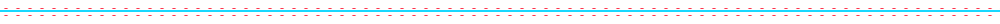

<h1>
  <code>HEY EVERYONE. I'M SHOUVANIK SANTRA</code> 
  <code>(@Shouvanik21)</code>
</h1>

<h4>⚡ Brooklyn's One and Only Open-Source Spider-Man // Building Full-Stack Web Apps &amp; ML-Powered Tools from Howrah ⚡</h4>

 

## 🕷️ The Spider-Sense Origin Story

<table>
<tr>
<td width="32%" align="center" valign="middle">
  
   <code>// SPIDER-SENSE: TINGLING</code>
</td>
<td width="68%" valign="top">

### 🕷️ Origin Story

When I'm not swinging through the digital cityscape, I'm a **final-year B.Tech student in Electronics & Communication Engineering** at MCKV Institute of Engineering, based in **Howrah, West Bengal**. I got bitten by the coding bug while wiring circuits and writing code side by side, and I've been developing web-slinging solutions ever since, from a **MERN-stack internship at Ardent Computech** to ML pipelines that read handwriting and filter spam.

I have a deep passion for **Full-Stack Web Development**, **Machine Learning & NLP**, and **Communication Systems**. My *spidey-sense* is currently focused on mastering: **RAG pipelines and production-grade full-stack architecture**.

> *"With great repository access comes great responsibility."*

</td>
</tr>
</table>

## 🧰 The Tech Arsenal

> Every logo gets the Spider-Verse treatment via the red/blue offset frame below. Edit the `i=` lists to match your real stack.

<table align="center">
<tr>
<td align="right" width="220"><h4>🎨 Frontend Fabrication</h4></td>
<td>

</td>
</tr>
<tr>
<td align="right"><h4>🔧 Backend Architecture</h4></td>
<td>

</td>
</tr>
<tr>
<td align="right"><h4>🚀 Web-Slinging DevOps</h4></td>
<td>

</td>
</tr>
<tr>
<td align="right"><h4>🛠️ Utility Belt Tools</h4></td>
<td>

</td>
</tr>
</table>

## 📊 The Multiverse Contributions

 

 

 

<!-- Crimson contribution snake: needs .github/workflows/snake.yml (included) -->

## 🌀 Notable Anomaly Reports

<table>
<tr>
<td width="33%" valign="top" align="center">
  

#### BhashaLens

An anomaly detected in **Python, OCR & RAG**. This project features **handwritten English and Hindi document recognition with image preprocessing and knowledge verification** that helps users turn paper into searchable text.

[**⟶ OPEN THE PORTAL**](https://github.com/Shouvanik21/BhashaLens)
</td>
<td width="33%" valign="top" align="center">
  

#### SmartMail

An anomaly detected in **Python, TF-IDF & scikit-learn**. This project features **a three-algorithm comparison reaching 98.26% accuracy** that helps users keep spam out and triage their inbox automatically.

[**⟶ OPEN THE PORTAL**](https://github.com/Shouvanik21/SmartMail__ML-Based-Email-Spam-Detection-and-Automated-Triage)
</td>
<td width="33%" valign="top" align="center">
  

#### NASA Image Explorer

An anomaly detected in **JavaScript & NASA's API**. This project features **an interactive space-imagery browser** that helps users explore celestial objects and astronomical content.

[**⟶ OPEN THE PORTAL**](https://github.com/Shouvanik21/NASA_image_explorer)
</td>
</tr>
</table>

## 📡 Establishing the Feed

### 🕸️ Latest Web-Swings

<!--COMMITS:START-->
🕷️ *Feed initializing… the first workflow run will fill this in.*
<!--COMMITS:END-->

### 🎧 Now Playing

**What Miles is currently listening to on his headphones:**

## 📟 Paging Spider-Man

  

<code>// END OF TRANSMISSION · EARTH-1610 · ANYONE CAN WEAR THE MASK</code>

