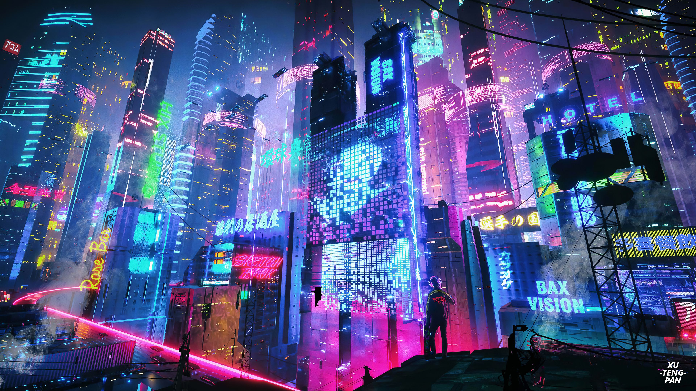

<h1>  🕷️ HEY EVERYONE. I'M SHOUVANIK SANTRA.
</h1><h3>
  <code>@Shouvanik21</code>
</h3><h4>
  BROOKLYN'S ONE AND ONLY OPEN-SOURCE SPIDER-MAN
 

  ECE STUDENT • ASPIRING AI/ML ENGINEER • FULL-STACK DEVELOPER

</h4>

  <strong>BUILDING INTELLIGENT SYSTEMS. CONNECTING DIGITAL WORLDS. BREAKING LIMITS.</strong>

<a href="https://github.com/Shouvanik21">  
</a><a href="https://github.com/Shouvanik21?tab=repositories">
  
</a>

<!-- ═══════════════════════════════════════════════════════════════ --><!-- SECTION 02 // THE SPIDER-SENSE ORIGIN STORY                     --><!-- ═══════════════════════════════════════════════════════════════ -->
<h2>🕸️ 02 // THE SPIDER-SENSE ORIGIN STORY</h2><h4>EVERY HERO HAS AN ORIGIN. EVERY DEVELOPER HAS A FIRST COMMIT.</h4>
<table width="100%"><tr><td width="35%" valign="middle">

<b>EARTH-1610 // CHARACTER PROFILE</b>

</td><td width="65%" valign="middle">🕷️ ORIGIN STORY
Hey! I'm Shouvanik Santra, an Electronics and Communication Engineering student exploring the intersection of artificial intelligence, machine learning, and software engineering.

My journey into the digital multiverse started with curiosity about how technology works and evolved into a passion for building intelligent applications and solving real-world problems through code.

I enjoy transforming complex ideas into practical systems, from machine learning models and Retrieval-Augmented Generation pipelines to full-stack applications and data analytics platforms.

My development journey revolves around three major dimensions:

- 🧠 Artificial Intelligence: Machine Learning, Deep Learning, Generative AI, LLMs, RAG, embeddings, and intelligent applications.
- ⚙️ Software Engineering: Python, JavaScript, APIs, backend development, databases, and application architecture.
- 📊 Data & Intelligence: SQL, Pandas, data preprocessing, analytics, visualization, and business intelligence.
  CURRENT MISSION: Strengthening my foundations in AI/ML engineering, Agentic AI, PyTorch/TensorFlow, FastAPI, and scalable data systems.

MY MOTTO:
"With great repository access comes great responsibility."

</td></tr></table>
⚡ CHARACTER ATTRIBUTES // SPIDER-SENSE SCAN

<table width="100%"><tr><td width="25%">
<h3>🧠</h3><b>AI / ML</b>

INTELLIGENCE ENGINE

</td><td width="25%">
<h3>🕸️</h3>
<b>GENERATIVE AI</b>

KNOWLEDGE NETWORK

</td><td width="25%">
<h3>⚙️</h3>
<b>DEVELOPMENT</b>

BUILDING SYSTEMS

</td><td width="25%">
<h3>📊</h3>
<b>ANALYTICS</b>

DATA INTELLIGENCE

</td></tr></table><!-- ═══════════════════════════════════════════════════════════════ --><!-- SECTION 03 // THE TECH ARSENAL                                  --><!-- ═══════════════════════════════════════════════════════════════ -->
<h2>⚙️ 03 // THE TECH ARSENAL</h2><h4>EVERY SPIDER-MAN NEEDS A WEB-SHOOTER. EVERY DEVELOPER NEEDS A TECH STACK.</h4>
🎨 03.1 // FRONTEND FABRICATION
THE VISUAL INTERFACE OF THE MULTIVERSE

  

| Technology   | Mission                          |

| :----------- | :------------------------------- |

| HTML5        | Semantic web structure           |

| CSS3         | Responsive visual experiences    |

| JavaScript   | Interactive application logic    |

| TypeScript   | Type-safe development            |

| React        | Component-based user interfaces  |

| Tailwind CSS | Utility-first styling            |

| Vite         | Modern frontend tooling          |

| Figma        | Interface design and prototyping |
🔧 03.2 // BACKEND ARCHITECTURE
THE ENGINE THAT POWERS THE WEB-SLINGING SYSTEM

  

| Technology | Mission                        |

| :--------- | :----------------------------- |

| Python     | AI/ML and backend development  |

| Java       | Object-oriented programming    |

| Node.js    | Server-side JavaScript         |

| Express.js | REST API development           |

| FastAPI    | Modern Python API development  |

| MySQL      | Relational database management |

| PostgreSQL | Relational data systems        |

| MongoDB    | Document-oriented database     |
🧠 03.3 // ARTIFICIAL INTELLIGENCE & MACHINE LEARNING
THE SPIDER-SENSE // INTELLIGENCE BEYOND THE ORDINARY

  

  

  

  

  

  

  

  

  

  

  

| Domain                  | Technologies / Concepts                       |

| :---------------------- | :-------------------------------------------- |

| Data Science            | NumPy, Pandas, Matplotlib                     |

| Machine Learning        | Scikit-learn, classification, regression      |

| Deep Learning           | TensorFlow/Keras, PyTorch                     |

| Generative AI           | LLMs, prompt engineering, API integration     |

| RAG Systems             | LangChain, embeddings, ChromaDB               |

| NLP                     | Text processing, OCR, language identification |

| Application Development | Streamlit, FastAPI                            |
🚀 03.4 // WEB-SLINGING DEVOPS & DATA ENGINEERING
SCALING SYSTEMS ACROSS DIMENSIONS

  

  

  

  

  

  

  

| Technology | Mission                        |

| :--------- | :----------------------------- |

| Git        | Version control                |

| GitHub     | Collaboration and repositories |

| Linux      | Development environment        |

| Docker     | Containerization               |

| Azure      | Cloud ecosystem                |

| PySpark    | Distributed data processing    |

| Snowflake  | Cloud data warehousing         |

| Power BI   | Business intelligence          |

| Tableau    | Data visualization             |
🛠️ 03.5 // UTILITY BELT
THE TOOLS THAT MAKE EVERY MISSION POSSIBLE

  

  

  

  

  

<!-- ═══════════════════════════════════════════════════════════════ --><!-- SECTION 04 // THE MULTIVERSE CONTRIBUTIONS                      --><!-- ═══════════════════════════════════════════════════════════════ -->
<h2>🌌 04 // THE MULTIVERSE CONTRIBUTIONS</h2><h4>EVERY COMMIT CREATES ANOTHER POSSIBILITY.</h4>

🩸 THE CRIMSON CONTRIBUTION DIMENSION

BLACK → DEEP CRIMSON → NEON RED // ACTIVITY INTENSITY

<!-- ### 📡 MULTIVERSE STATISTICS

   -->🔥 SPIDER-STREAK COUNTER

<!-- ### 📈 ACTIVITY ACROSS THE MULTIVERSE

 -->

<b>🕸️ OPEN THE MULTIVERSE DATA LOG // HOW THESE STATISTICS WORK</b>

- Main Statistics: Repository activity, contributions, commits, pull requests, and stars supported by the GitHub statistics service.
- Language Distribution: Languages detected in public repositories.
- Streak Counter: Current and longest contribution streak.
- Contribution Heatmap: Daily contribution intensity represented through a crimson palette.
- Activity Graph: Contribution history displayed as a dynamic graph.
Important: These services depend on external APIs and their own caching. Private contributions may require configuration and may not be available from every service. Displayed statistics can differ slightly between providers.

<!-- ═══════════════════════════════════════════════════════════════ --><!-- SECTION 05 // NOTABLE ANOMALY REPORTS                           --><!-- ═══════════════════════════════════════════════════════════════ -->
<h2>🌀 05 // NOTABLE ANOMALY REPORTS</h2><h4>THE GO-HOME MACHINE // PORTFOLIO DIMENSIONAL GATEWAY</h4>
THREE MAJOR ANOMALIES DETECTED // CLASSIFICATION: DEVELOPER PROJECTS

<table width="100%"><tr><td width="50%" valign="top">
🧠 ANOMALY 001
BHASHALENS
MULTILINGUAL DOCUMENT INTELLIGENCE

A document intelligence system designed to transform handwritten documents into searchable and verifiable knowledge.

Core capabilities:

- Handwritten document OCR using PaddleOCR.
- Image preprocessing and OCR correction.
- English and Hindi language support.
- Text chunking and embedding generation.
- ChromaDB vector storage.
- LangChain-powered Retrieval-Augmented Generation.
- Knowledge retrieval and verification.
  Technology stack:

Python PaddleOCR LangChain ChromaDB RAG

</td><td width="50%" valign="top">
⚡ ANOMALY 002
CREDIT RISK PREDICTION
MACHINE LEARNING CLASSIFICATION

A machine learning-based credit risk assessment system that predicts whether a loan applicant is likely to default or successfully repay a loan.

Core capabilities:

- Loan applicant data preprocessing and feature preparation.
- Exploratory data analysis.
- Feature scaling and transformation.
- Support Vector Machine (SVM) model training.
- Credit default prediction (Default / No Default).
- Model evaluation using classification metrics.
- Saved preprocessing artifacts and trained model for predictions.
  Technology stack:

Python Pandas NumPy Scikit-learn SVM Machine Learning

</td></tr><tr><td width="50%" valign="top">
📊 ANOMALY 003
GLOBAL RETAIL CUSTOMER 360
SALES INTELLIGENCE & CUSTOMER ANALYTICS

An end-to-end retail analytics solution that transforms transactional sales data into meaningful business intelligence.

Core capabilities:

- Data profiling and quality assessment.
- Cleaning and preprocessing.
- MySQL database integration.
- Python-based analytics.
- Revenue and sales KPIs.
- Return and cancellation analysis.
- RFM customer segmentation.
- Executive dashboard development.
  Technology stack:

Python Pandas MySQL SQL Power BI

</td><td width="50%" valign="top">
📨 ANOMALY 004
SMARTMAIL
INTELLIGENT SPAM DETECTION

A machine learning-based email classification system that distinguishes legitimate messages from spam using natural language processing.

Core capabilities:

- Text cleaning and preprocessing.
- TF-IDF feature extraction.
- Multiple classification model comparison.
- Linear SVM classification.
- Performance evaluation.
- Precision, recall, and F1-score analysis.
  Reported model performance:
- Accuracy: 98.26%
- F1-score: 92.91%
  Technology stack:

Python Pandas Scikit-learn TF-IDF Linear SVM

</td></tr></table>

🕸️ MORE DIMENSIONS // MORE EXPERIMENTS
THE MULTIVERSE IS BIGGER THAN FOUR PROJECTS.

<!-- ═══════════════════════════════════════════════════════════════ --><!-- SECTION 06 // ESTABLISHING THE FEED                             --><!-- ═══════════════════════════════════════════════════════════════ -->
<h2>📡 06 // ESTABLISHING THE FEED</h2><h4>LIVE SIGNALS FROM EARTH-1610</h4>
🕷️ 06.1 // LATEST TRANSMISSIONS
RECENT GITHUB ACTIVITY // AUTOMATICALLY UPDATED
<!--START_SECTION:activity--><!--

Configure a GitHub Actions workflow to update this region.

See the setup instructions following this README.

-->- 🕷️ Latest repository transmission will appear here.

- 🕷️ Recent commits will be synchronized automatically.
- 🕷️ Pull requests and other GitHub activity can be tracked here.
  <!--END_SECTION:activity-->🎧 06.2 // WHAT MILES IS CURRENTLY LISTENING TO
  
🎵 THE HEADPHONES TRANSMISSION
  "What Miles is currently listening to on his headphones:"
  <!-- Replace with your configured Spotify widget -->

CONNECT A SPOTIFY INTEGRATION TO DISPLAY YOUR LIVE TRACK.

🛰️ 06.3 // OPEN-SOURCE SIGNAL

<b>⚙️ LIVE FEED CONFIGURATION // DEVELOPER ACCESS</b>
Latest activity: Configure GitHub Actions to populate the activity region using a GitHub activity README updater.

Spotify: Configure a Spotify integration using your Spotify account ID and the required OAuth credentials. A public widget service or your own GitHub Action can render the currently playing track.

Security protocol: Never place Spotify client secrets, refresh tokens, GitHub personal access tokens, or other credentials directly in README.md. Use GitHub Actions Secrets.

<!-- ═══════════════════════════════════════════════════════════════ --><!-- SECTION 07 // PAGING SPIDER-MAN                                 --><!-- ═══════════════════════════════════════════════════════════════ -->
<h2>📞 07 // PAGING SPIDER-MAN</h2><h4>EVERY MULTIVERSE NEEDS CONNECTIONS.</h4>

🕸️ OPEN A COMMUNICATION CHANNEL
Have an interesting idea, an AI project, a collaboration opportunity, or a problem worth solving?

SEND THE SIGNAL. I'M LISTENING.

🕷️ THE SPIDER-VERSE DEVELOPER DIRECTIVE
"Anyone can wear the mask. The real power is in what you build while wearing it."

THANK YOU FOR VISITING MY MULTIVERSE.

IF YOU MADE IT THIS FAR, YOU'RE OFFICIALLY PART OF EARTH-1610.

© SHOUVANIK SANTRA // EARTH-1610 // ALL DIMENSIONS CONNECTED

<!--

══════════════════════════════════════════════════════════════════════

                         END OF TRANSMISSION

══════════════════════════════════════════════════════════════════════

-->
