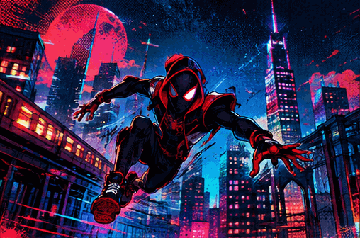
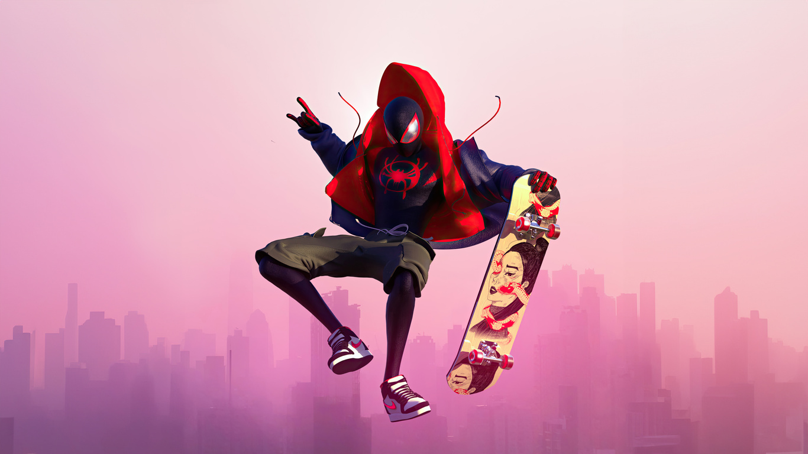
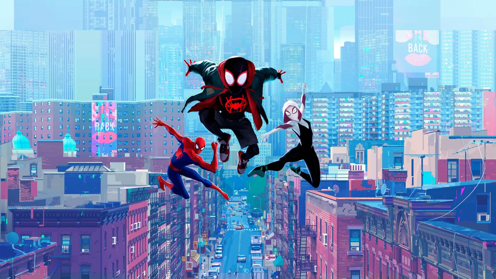
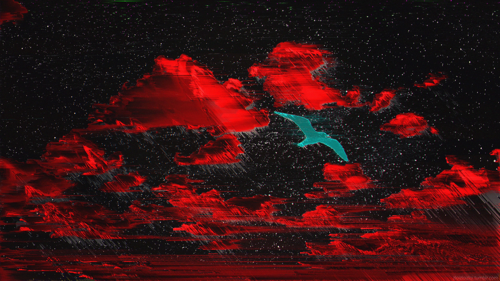
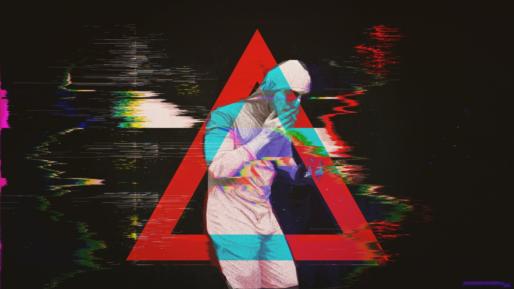

 

<h1>🕷️ HEY EVERYONE. I'M SHOUVANIK SANTRA.</h1>

<h4>BROOKLYN'S ONE AND ONLY OPEN-SOURCE SPIDER-MAN  ||  ECE STUDENT • ASPIRING AI/ML ENGINEER • FULL-STACK DEVELOPER</h4>

<strong>BUILDING INTELLIGENT SYSTEMS. CONNECTING DIGITAL WORLDS. BREAKING LIMITS.</strong>

 

 

 

 

<!-- ═══════════════════════════════════════════════════════════════ -->
<!-- SECTION 02 // THE SPIDER-SENSE ORIGIN STORY                     -->
<!-- ═══════════════════════════════════════════════════════════════ -->

<h2>🕸️ THE SPIDER-SENSE ORIGIN STORY</h2>

<h4>EVERY HERO HAS AN ORIGIN. EVERY DEVELOPER HAS A FIRST COMMIT.</h4>

<table width="100%">
<tr>
<td width="35%" align="center" valign="middle">

 

<b>𝙴𝙰𝚁𝚃𝙷-𝟷𝟼𝟷𝟶 || 𝙲𝙷𝙰𝚁𝙰𝙲𝚃𝙴𝚁 𝙿𝚁𝙾𝙵𝙸𝙻𝙴</b>

  

</td>
<td width="65%" valign="middle">

🕷️ 𝙷𝚎𝚢! 𝙸'𝚖 𝚂𝚑𝚘𝚞𝚟𝚊𝚗𝚒𝚔 𝚂𝚊𝚗𝚝𝚛𝚊, 𝚊𝚗 𝙴𝚕𝚎𝚌𝚝𝚛𝚘𝚗𝚒𝚌𝚜 𝚊𝚗𝚍 𝙲𝚘𝚖𝚖𝚞𝚗𝚒𝚌𝚊𝚝𝚒𝚘𝚗 𝙴𝚗𝚐𝚒𝚗𝚎𝚎𝚛𝚒𝚗𝚐 𝚜𝚝𝚞𝚍𝚎𝚗𝚝 𝚎𝚡𝚙𝚕𝚘𝚛𝚒𝚗𝚐 𝚝𝚑𝚎 𝚒𝚗𝚝𝚎𝚛𝚜𝚎𝚌𝚝𝚒𝚘𝚗 𝚘𝚏 𝚊𝚛𝚝𝚒𝚏𝚒𝚌𝚒𝚊𝚕 𝚒𝚗𝚝𝚎𝚕𝚕𝚒𝚐𝚎𝚗𝚌𝚎, 𝚖𝚊𝚌𝚑𝚒𝚗𝚎 𝚕𝚎𝚊𝚛𝚗𝚒𝚗𝚐, 𝚊𝚗𝚍 𝚜𝚘𝚏𝚝𝚠𝚊𝚛𝚎 𝚎𝚗𝚐𝚒𝚗𝚎𝚎𝚛𝚒𝚗𝚐.

𝙼𝚢 𝚓𝚘𝚞𝚛𝚗𝚎𝚢 𝚒𝚗𝚝𝚘 𝚝𝚑𝚎 𝚍𝚒𝚐𝚒𝚝𝚊𝚕 𝚖𝚞𝚕𝚝𝚒𝚟𝚎𝚛𝚜𝚎 𝚜𝚝𝚊𝚛𝚝𝚎𝚍 𝚠𝚒𝚝𝚑 𝚌𝚞𝚛𝚒𝚘𝚜𝚒𝚝𝚢 𝚊𝚋𝚘𝚞𝚝 𝚑𝚘𝚠 𝚝𝚎𝚌𝚑𝚗𝚘𝚕𝚘𝚐𝚢 𝚠𝚘𝚛𝚔𝚜 𝚊𝚗𝚍 𝚎𝚟𝚘𝚕𝚟𝚎𝚍 𝚒𝚗𝚝𝚘 𝚊 𝚙𝚊𝚜𝚜𝚒𝚘𝚗 𝚏𝚘𝚛 𝚋𝚞𝚒𝚕𝚍𝚒𝚗𝚐 𝚒𝚗𝚝𝚎𝚕𝚕𝚒𝚐𝚎𝚗𝚝 𝚊𝚙𝚙𝚕𝚒𝚌𝚊𝚝𝚒𝚘𝚗𝚜 𝚊𝚗𝚍 𝚜𝚘𝚕𝚟𝚒𝚗𝚐 𝚛𝚎𝚊𝚕-𝚠𝚘𝚛𝚕𝚍 𝚙𝚛𝚘𝚋𝚕𝚎𝚖𝚜 𝚝𝚑𝚛𝚘𝚞𝚐𝚑 𝚌𝚘𝚍𝚎.

𝙸 𝚎𝚗𝚓𝚘𝚢 𝚝𝚛𝚊𝚗𝚜𝚏𝚘𝚛𝚖𝚒𝚗𝚐 𝚌𝚘𝚖𝚙𝚕𝚎𝚡 𝚒𝚍𝚎𝚊𝚜 𝚒𝚗𝚝𝚘 𝚙𝚛𝚊𝚌𝚝𝚒𝚌𝚊𝚕 𝚜𝚢𝚜𝚝𝚎𝚖𝚜, 𝚏𝚛𝚘𝚖 𝚖𝚊𝚌𝚑𝚒𝚗𝚎 𝚕𝚎𝚊𝚛𝚗𝚒𝚗𝚐 𝚖𝚘𝚍𝚎𝚕𝚜 𝚊𝚗𝚍 𝚁𝚎𝚝𝚛𝚒𝚎𝚟𝚊𝚕-𝙰𝚞𝚐𝚖𝚎𝚗𝚝𝚎𝚍 𝙶𝚎𝚗𝚎𝚛𝚊𝚝𝚒𝚘𝚗 𝚙𝚒𝚙𝚎𝚕𝚒𝚗𝚎𝚜 𝚝𝚘 𝚏𝚞𝚕𝚕-𝚜𝚝𝚊𝚌𝚔 𝚊𝚙𝚙𝚕𝚒𝚌𝚊𝚝𝚒𝚘𝚗𝚜 𝚊𝚗𝚍 𝚍𝚊𝚝𝚊 𝚊𝚗𝚊𝚕𝚢𝚝𝚒𝚌𝚜 𝚙𝚕𝚊𝚝𝚏𝚘𝚛𝚖𝚜.

𝙼𝚢 𝚍𝚎𝚟𝚎𝚕𝚘𝚙𝚖𝚎𝚗𝚝 𝚓𝚘𝚞𝚛𝚗𝚎𝚢 𝚛𝚎𝚟𝚘𝚕𝚟𝚎𝚜 𝚊𝚛𝚘𝚞𝚗𝚍 𝚝𝚑𝚛𝚎𝚎 𝚖𝚊𝚓𝚘𝚛 𝚍𝚒𝚖𝚎𝚗𝚜𝚒𝚘𝚗𝚜:

- 🧠 𝗔𝗿𝘁𝗶𝗳𝗶𝗰𝗶𝗮𝗹 𝗜𝗻𝘁𝗲𝗹𝗹𝗶𝗴𝗲𝗻𝗰𝗲: 𝙼𝚊𝚌𝚑𝚒𝚗𝚎 𝙻𝚎𝚊𝚛𝚗𝚒𝚗𝚐, 𝙳𝚎𝚎𝚙 𝙻𝚎𝚊𝚛𝚗𝚒𝚗𝚐, 𝙶𝚎𝚗𝚎𝚛𝚊𝚝𝚒𝚟𝚎 𝙰𝙸, 𝙻𝙻𝙼𝚜, 𝚁𝙰𝙶, 𝚎𝚖𝚋𝚎𝚍𝚍𝚒𝚗𝚐𝚜, 𝚊𝚗𝚍 𝚒𝚗𝚝𝚎𝚕𝚕𝚒𝚐𝚎𝚗𝚝 𝚊𝚙𝚙𝚕𝚒𝚌𝚊𝚝𝚒𝚘𝚗𝚜.
- ⚙️ 𝗦𝗼𝗳𝘁𝘄𝗮𝗿𝗲 𝗘𝗻𝗴𝗶𝗻𝗲𝗲𝗿𝗶𝗻𝗴: 𝙿𝚢𝚝𝚑𝚘𝚗, 𝙹𝚊𝚟𝚊𝚂𝚌𝚛𝚒𝚙𝚝, 𝙰𝙿𝙸𝚜, 𝚋𝚊𝚌𝚔𝚎𝚗𝚍 𝚍𝚎𝚟𝚎𝚕𝚘𝚙𝚖𝚎𝚗𝚝, 𝚍𝚊𝚝𝚊𝚋𝚊𝚜𝚎𝚜, 𝚊𝚗𝚍 𝚊𝚙𝚙𝚕𝚒𝚌𝚊𝚝𝚒𝚘𝚗 𝚊𝚛𝚌𝚑𝚒𝚝𝚎𝚌𝚝𝚞𝚛𝚎.
- 📊 𝗗𝗮𝘁𝗮 & 𝗜𝗻𝘁𝗲𝗹𝗹𝗶𝗴𝗲𝗻𝗰𝗲: 𝚂𝚀𝙻, 𝙿𝚊𝚗𝚍𝚊𝚜, 𝚍𝚊𝚝𝚊 𝚙𝚛𝚎𝚙𝚛𝚘𝚌𝚎𝚜𝚜𝚒𝚗𝚐, 𝚊𝚗𝚊𝚕𝚢𝚝𝚒𝚌𝚜, 𝚟𝚒𝚜𝚞𝚊𝚕𝚒𝚣𝚊𝚝𝚒𝚘𝚗, 𝚊𝚗𝚍 𝚋𝚞𝚜𝚒𝚗𝚎𝚜𝚜 𝚒𝚗𝚝𝚎𝚕𝚕𝚒𝚐𝚎𝚗𝚌𝚎.

𝗖𝗨𝗥𝗥𝗘𝗡𝗧 𝗠𝗜𝗦𝗦𝗜𝗢𝗡: 𝚂𝚝𝚛𝚎𝚗𝚐𝚝𝚑𝚎𝚗𝚒𝚗𝚐 𝚖𝚢 𝚏𝚘𝚞𝚗𝚍𝚊𝚝𝚒𝚘𝚗𝚜 𝚒𝚗 𝙰𝙸/𝙼𝙻 𝚎𝚗𝚐𝚒𝚗𝚎𝚎𝚛𝚒𝚗𝚐, 𝙰𝚐𝚎𝚗𝚝𝚒𝚌 𝙰𝙸, 𝙿𝚢𝚃𝚘𝚛𝚌𝚑/𝚃𝚎𝚗𝚜𝚘𝚛𝙵𝚕𝚘𝚠, 𝙵𝚊𝚜𝚝𝙰𝙿𝙸, 𝚊𝚗𝚍 𝚜𝚌𝚊𝚕𝚊𝚋𝚕𝚎 𝚍𝚊𝚝𝚊 𝚜𝚢𝚜𝚝𝚎𝚖𝚜.

𝗠𝗬 𝗠𝗢𝗧𝗧𝗢: "𝚆𝚒𝚝𝚑 𝚐𝚛𝚎𝚊𝚝 𝚛𝚎𝚙𝚘𝚜𝚒𝚝𝚘𝚛𝚢 𝚊𝚌𝚌𝚎𝚜𝚜 𝚌𝚘𝚖𝚎𝚜 𝚐𝚛𝚎𝚊𝚝 𝚛𝚎𝚜𝚙𝚘𝚗𝚜𝚒𝚋𝚒𝚕𝚒𝚝𝚢."

</td>
</tr>
</table>

  

  

<h3>⚡ 𝙲𝙷𝙰𝚁𝙰𝙲𝚃𝙴𝚁 𝙰𝚃𝚃𝚁𝙸𝙱𝚄𝚃𝙴𝚂 || 𝚂𝙿𝙸𝙳𝙴𝚁-𝚂𝙴𝙽𝚂𝙴 𝚂𝙲𝙰𝙽</h3>

 

<table width="100%" align="center">
<tr>
<td align="center" width="25%">
<h3>🧠</h3>
<b>𝗔𝗜 / 𝗠𝗟</b> 
𝙸𝙽𝚃𝙴𝙻𝙻𝙸𝙶𝙴𝙽𝙲𝙴 𝙴𝙽𝙶𝙸𝙽𝙴
</td>
<td align="center" width="25%">
<h3>🕸️</h3>
<b>𝗚𝗘𝗡𝗘𝗥𝗔𝗧𝗜𝗩𝗘 𝗔𝗜</b> 
𝙺𝙽𝙾𝚆𝙻𝙴𝙳𝙶𝙴 𝙽𝙴𝚃𝚆𝙾𝚁𝙺
</td>
<td align="center" width="25%">
<h3>⚙️</h3>
<b>𝗗𝗘𝗩𝗘𝗟𝗢𝗣𝗠𝗘𝗡𝗧</b> 
𝙱𝚄𝙸𝙻𝙳𝙸𝙽𝙶 𝚂𝚈𝚂𝚃𝙴𝙼𝚂
</td>
<td align="center" width="25%">
<h3>📊</h3>
<b>𝗔𝗡𝗔𝗟𝗬𝗧𝗜𝗖𝗦</b> 
𝙳𝙰𝚃𝙰 𝙸𝙽𝚃𝙴𝙻𝙻𝙸𝙶𝙴𝙽𝙲𝙴
</td>
</tr>
</table>

 

<!-- ═══════════════════════════════════════════════════════════════ -->
<!-- SECTION 03 // THE TECH ARSENAL -->
<!-- ═══════════════════════════════════════════════════════════════ -->

<h2>⚙️ THE TECH ARSENAL</h2>

<h4>EVERY SPIDER-MAN NEEDS A WEB-SHOOTER. EVERY DEVELOPER NEEDS A TECH STACK.</h4>

 

<h3 align="center">🎨 FRONTEND FABRICATION</h3>

THE VISUAL INTERFACE OF THE MULTIVERSE

  

  
  
  
  
  
  
  

<table align="center" width="70%">
<tr><th width="30%">𝗧𝗲𝗰𝗵𝗻𝗼𝗹𝗼𝗴𝘆</th><th width="70%">𝗠𝗶𝘀𝘀𝗶𝗼𝗻</th></tr>
<tr><td align="center">𝗛𝗧𝗠𝗟𝟱</td><td align="center">𝚂𝚎𝚖𝚊𝚗𝚝𝚒𝚌 𝚠𝚎𝚋 𝚜𝚝𝚛𝚞𝚌𝚝𝚞𝚛𝚎</td></tr>
<tr><td align="center">𝗖𝗦𝗦𝟯</td><td align="center">𝚁𝚎𝚜𝚙𝚘𝚗𝚜𝚒𝚟𝚎 𝚟𝚒𝚜𝚞𝚊𝚕 𝚎𝚡𝚙𝚎𝚛𝚒𝚎𝚗𝚌𝚎𝚜</td></tr>
<tr><td align="center">𝗝𝗮𝘃𝗮𝗦𝗰𝗿𝗶𝗽𝘁</td><td align="center">𝙸𝚗𝚝𝚎𝚛𝚊𝚌𝚝𝚒𝚟𝚎 𝚊𝚙𝚙𝚕𝚒𝚌𝚊𝚝𝚒𝚘𝚗 𝚕𝚘𝚐𝚒𝚌</td></tr>
<tr><td align="center">𝗥𝗲𝗮𝗰𝘁</td><td align="center">𝙲𝚘𝚖𝚙𝚘𝚗𝚎𝚗𝚝-𝚋𝚊𝚜𝚎𝚍 𝚞𝚜𝚎𝚛 𝚒𝚗𝚝𝚎𝚛𝚏𝚊𝚌𝚎𝚜</td></tr>
<tr><td align="center">𝗧𝗮𝗶𝗹𝘄𝗶𝗻𝗱 𝗖𝗦𝗦</td><td align="center">𝚄𝚝𝚒𝚕𝚒𝚝𝚢-𝚏𝚒𝚛𝚜𝚝 𝚜𝚝𝚢𝚕𝚒𝚗𝚐</td></tr>
<tr><td align="center">𝗩𝗶𝘁𝗲</td><td align="center">𝙼𝚘𝚍𝚎𝚛𝚗 𝚏𝚛𝚘𝚗𝚝𝚎𝚗𝚍 𝚝𝚘𝚘𝚕𝚒𝚗𝚐</td></tr>
<tr><td align="center">𝗙𝗶𝗴𝗺𝗮</td><td align="center">𝙸𝚗𝚝𝚎𝚛𝚏𝚊𝚌𝚎 𝚍𝚎𝚜𝚒𝚐𝚗 𝚊𝚗𝚍 𝚙𝚛𝚘𝚝𝚘𝚝𝚢𝚙𝚒𝚗𝚐</td></tr>
</table>

 

<h3 align="center">🔧 BACKEND ARCHITECTURE</h3>

THE ENGINE THAT POWERS THE WEB-SLINGING SYSTEM

  

  
  
  
  
  
  
  

<table align="center" width="70%">
<tr><th width="30%">𝗧𝗲𝗰𝗵𝗻𝗼𝗹𝗼𝗴𝘆</th><th width="70%">𝗠𝗶𝘀𝘀𝗶𝗼𝗻</th></tr>
<tr><td align="center">𝗣𝘆𝘁𝗵𝗼𝗻</td><td align="center">𝙰𝙸/𝙼𝙻 𝚊𝚗𝚍 𝚋𝚊𝚌𝚔𝚎𝚗𝚍 𝚍𝚎𝚟𝚎𝚕𝚘𝚙𝚖𝚎𝚗𝚝</td></tr>
<tr><td align="center">𝗝𝗮𝘃𝗮</td><td align="center">𝙾𝚋𝚓𝚎𝚌𝚝-𝚘𝚛𝚒𝚎𝚗𝚝𝚎𝚍 𝚙𝚛𝚘𝚐𝚛𝚊𝚖𝚖𝚒𝚗𝚐</td></tr>
<tr><td align="center">𝗡𝗼𝗱𝗲.𝗷𝘀</td><td align="center">𝚂𝚎𝚛𝚟𝚎𝚛-𝚜𝚒𝚍𝚎 𝙹𝚊𝚟𝚊𝚂𝚌𝚛𝚒𝚙𝚝</td></tr>
<tr><td align="center">𝗘𝘅𝗽𝗿𝗲𝘀𝘀.𝗷𝘀</td><td align="center">𝚁𝙴𝚂𝚃 𝙰𝙿𝙸 𝚍𝚎𝚟𝚎𝚕𝚘𝚙𝚖𝚎𝚗𝚝</td></tr>
<tr><td align="center">𝗙𝗮𝘀𝘁𝗔𝗣𝗜</td><td align="center">𝙼𝚘𝚍𝚎𝚛𝚗 𝙿𝚢𝚝𝚑𝚘𝚗 𝙰𝙿𝙸 𝚍𝚎𝚟𝚎𝚕𝚘𝚙𝚖𝚎𝚗𝚝</td></tr>
<tr><td align="center">𝗠𝘆𝗦𝗤𝗟</td><td align="center">𝚁𝚎𝚕𝚊𝚝𝚒𝚘𝚗𝚊𝚕 𝚍𝚊𝚝𝚊𝚋𝚊𝚜𝚎 𝚖𝚊𝚗𝚊𝚐𝚎𝚖𝚎𝚗𝚝</td></tr>
<tr><td align="center">𝗠𝗼𝗻𝗴𝗼𝗗𝗕</td><td align="center">𝙳𝚘𝚌𝚞𝚖𝚎𝚗𝚝-𝚘𝚛𝚒𝚎𝚗𝚝𝚎𝚍 𝚍𝚊𝚝𝚊𝚋𝚊𝚜𝚎</td></tr>
</table>

 

<h3 align="center">🧠 ARTIFICIAL INTELLIGENCE & MACHINE LEARNING</h3>

THE SPIDER-SENSE || INTELLIGENCE BEYOND THE ORDINARY

  

  
  
  
  
  
  
  
  
  
  

<table align="center" width="70%">
<tr><th width="30%">𝗗𝗼𝗺𝗮𝗶𝗻</th><th width="70%">𝗧𝗲𝗰𝗵𝗻𝗼𝗹𝗼𝗴𝗶𝗲𝘀 / 𝗖𝗼𝗻𝗰𝗲𝗽𝘁𝘀</th></tr>
<tr><td align="center">𝗗𝗮𝘁𝗮 𝗦𝗰𝗶𝗲𝗻𝗰𝗲</td><td align="center">𝙽𝚞𝚖𝙿𝚢, 𝙿𝚊𝚗𝚍𝚊𝚜, 𝙼𝚊𝚝𝚙𝚕𝚘𝚝𝚕𝚒𝚋</td></tr>
<tr><td align="center">𝗠𝗮𝗰𝗵𝗶𝗻𝗲 𝗟𝗲𝗮𝗿𝗻𝗶𝗻𝗴</td><td align="center">𝚂𝚌𝚒𝚔𝚒𝚝-𝚕𝚎𝚊𝚛𝚗, 𝚌𝚕𝚊𝚜𝚜𝚒𝚏𝚒𝚌𝚊𝚝𝚒𝚘𝚗, 𝚛𝚎𝚐𝚛𝚎𝚜𝚜𝚒𝚘𝚗</td></tr>
<tr><td align="center">𝗗𝗲𝗲𝗽 𝗟𝗲𝗮𝗿𝗻𝗶𝗻𝗴</td><td align="center">𝚃𝚎𝚗𝚜𝚘𝚛𝙵𝚕𝚘𝚠/𝙺𝚎𝚛𝚊𝚜</td></tr>
<tr><td align="center">𝗚𝗲𝗻𝗲𝗿𝗮𝘁𝗶𝘃𝗲 𝗔𝗜</td><td align="center">𝙻𝙻𝙼𝚜, 𝚙𝚛𝚘𝚖𝚙𝚝 𝚎𝚗𝚐𝚒𝚗𝚎𝚎𝚛𝚒𝚗𝚐, 𝙰𝙿𝙸 𝚒𝚗𝚝𝚎𝚐𝚛𝚊𝚝𝚒𝚘𝚗</td></tr>
<tr><td align="center">𝗥𝗔𝗚 𝗦𝘆𝘀𝘁𝗲𝗺𝘀</td><td align="center">𝙻𝚊𝚗𝚐𝙲𝚑𝚊𝚒𝚗, 𝚎𝚖𝚋𝚎𝚍𝚍𝚒𝚗𝚐𝚜, 𝙲𝚑𝚛𝚘𝚖𝚊𝙳𝙱</td></tr>
<tr><td align="center">𝗡𝗟𝗣</td><td align="center">𝚃𝚎𝚡𝚝 𝚙𝚛𝚘𝚌𝚎𝚜𝚜𝚒𝚗𝚐, 𝙾𝙲𝚁, 𝚕𝚊𝚗𝚐𝚞𝚊𝚐𝚎 𝚒𝚍𝚎𝚗𝚝𝚒𝚏𝚒𝚌𝚊𝚝𝚒𝚘𝚗</td></tr>
<tr><td align="center">𝗔𝗽𝗽𝗹𝗶𝗰𝗮𝘁𝗶𝗼𝗻 𝗗𝗲𝘃𝗲𝗹𝗼𝗽𝗺𝗲𝗻𝘁</td><td align="center">𝚂𝚝𝚛𝚎𝚊𝚖𝚕𝚒𝚝, 𝙵𝚊𝚜𝚝𝙰𝙿𝙸</td></tr>
</table>

 

<h3 align="center">🚀 WEB-SLINGING DEVOPS & DATA ENGINEERING</h3>

SCALING SYSTEMS ACROSS DIMENSIONS

  

  
  
  
  

<table align="center" width="70%">
<tr><th width="30%">𝗧𝗲𝗰𝗵𝗻𝗼𝗹𝗼𝗴𝘆</th><th width="70%">𝗠𝗶𝘀𝘀𝗶𝗼𝗻</th></tr>
<tr><td align="center">𝗚𝗶𝘁</td><td align="center">𝚅𝚎𝚛𝚜𝚒𝚘𝚗 𝚌𝚘𝚗𝚝𝚛𝚘𝚕</td></tr>
<tr><td align="center">𝗚𝗶𝘁𝗛𝘂𝗯</td><td align="center">𝙲𝚘𝚕𝚕𝚊𝚋𝚘𝚛𝚊𝚝𝚒𝚘𝚗 𝚊𝚗𝚍 𝚛𝚎𝚙𝚘𝚜𝚒𝚝𝚘𝚛𝚒𝚎𝚜</td></tr>
<tr><td align="center">𝗟𝗶𝗻𝘂𝘅</td><td align="center">𝙳𝚎𝚟𝚎𝚕𝚘𝚙𝚖𝚎𝚗𝚝 𝚎𝚗𝚟𝚒𝚛𝚘𝚗𝚖𝚎𝚗𝚝</td></tr>
<tr><td align="center">𝗣𝗼𝘄𝗲𝗿 𝗕𝗜</td><td align="center">𝙱𝚞𝚜𝚒𝚗𝚎𝚜𝚜 𝚒𝚗𝚝𝚎𝚕𝚕𝚒𝚐𝚎𝚗𝚌𝚎</td></tr>
</table>

 

<h3 align="center">🛠️ UTILITY BELT</h3>

THE TOOLS THAT MAKE EVERY MISSION POSSIBLE

  

  
  
  
  

 

<!-- ═══════════════════════════════════════════════════════════════ -->
<!-- SECTION 04 // THE MULTIVERSE CONTRIBUTIONS -->
<!-- ═══════════════════════════════════════════════════════════════ -->

<h2>🌌 THE MULTIVERSE CONTRIBUTIONS</h2>

<h4>EVERY COMMIT CREATES ANOTHER POSSIBILITY.</h4>

 

<h3>🩸 THE CRIMSON CONTRIBUTION DIMENSION</h3>

<h3>BLACK → DEEP CRIMSON → NEON RED || ACTIVITY INTENSITY</h3>

<!-- MULTIVERSE STATISTICS

  
 -->

<h3>🔥 SPIDER-STREAK COUNTER</h3>

  

<!-- ACTIVITY ACROSS THE MULTIVERSE

<h3>📈 ACTIVITY ACROSS THE MULTIVERSE</h3>

-->

<!-- 

<b>🕸️ OPEN THE MULTIVERSE DATA LOG // HOW THESE STATISTICS WORK</b>

 

- **Main Statistics:** Repository activity, contributions, commits, pull requests, and stars supported by the GitHub statistics service.
- **Language Distribution:** Languages detected in public repositories.
- **Streak Counter:** Current and longest contribution streak.
- **Contribution Heatmap:** Daily contribution intensity represented through a crimson palette.
- **Activity Graph:** Contribution history displayed as a dynamic graph.

**Important:** These services depend on external APIs and their own caching. Private contributions may require configuration and may not be available from every service. Displayed statistics can differ slightly between providers.

 -->

<!-- ═══════════════════════════════════════════════════════════════ -->
<!-- SECTION 05 // NOTABLE ANOMALY REPORTS -->
<!-- ═══════════════════════════════════════════════════════════════ -->

<h2>🌀 NOTABLE ANOMALY REPORTS</h2>

<h4>THE GO-HOME MACHINE -- PORTFOLIO DIMENSIONAL GATEWAY</h4>

  

<h3>FOUR MAJOR ANOMALIES DETECTED || CLASSIFICATION: DEVELOPER PROJECTS</h3>

  

 

<table width="100%">
<tr>

<!-- PROJECT 001 : BHASHALENS -->

<td width="50%" valign="top">

<h3>🧠 ANOMALY 001</h3>

<h3>BHASHALENS</h3>

<b>MULTILINGUAL DOCUMENT INTELLIGENCE</b>

 

A document intelligence system designed to transform handwritten documents into searchable and verifiable knowledge.

**Core capabilities:**

- Handwritten document OCR using PaddleOCR.
- Image preprocessing and OCR correction.
- English and Hindi language support.
- Text chunking and embedding generation.
- ChromaDB vector storage.
- LangChain-powered Retrieval-Augmented Generation.
- Knowledge retrieval and verification.

**Technology stack:**

Python · PaddleOCR · LangChain · ChromaDB · RAG

</td>

<!-- PROJECT 002 : CREDIT RISK -->

<td width="50%" valign="top">

<h3>⚡ ANOMALY 002</h3>

<h3>CREDIT RISK PREDICTION</h3>

<b>MACHINE LEARNING CLASSIFICATION</b>

 

A machine learning-based credit risk assessment system that predicts whether a loan applicant is likely to default or successfully repay a loan.

**Core capabilities:**

- Loan applicant data preprocessing and feature preparation.
- Exploratory data analysis.
- Feature scaling and transformation.
- Support Vector Machine (SVM) model training.
- Credit default prediction (Default / No Default).
- Model evaluation using classification metrics.
- Saved preprocessing artifacts and trained model for predictions.

**Technology stack:**

Python · Pandas · NumPy · Scikit-learn · SVM · Machine Learning

</td>
</tr>

<tr>

<!-- PROJECT 003 : GLOBAL RETAIL -->

<td width="50%" valign="top">

<h3>📊 ANOMALY 003</h3>

<h3>GLOBAL RETAIL CUSTOMER 360</h3>

<b>SALES INTELLIGENCE & CUSTOMER ANALYTICS</b>

 

An end-to-end retail analytics solution that transforms transactional sales data into meaningful business intelligence.

**Core capabilities:**

- Data profiling and quality assessment.
- Cleaning and preprocessing.
- MySQL database integration.
- Python-based analytics.
- Revenue and sales KPIs.
- Return and cancellation analysis.
- RFM customer segmentation.
- Executive dashboard development.

**Technology stack:**

Python · Pandas · MySQL · SQL · Power BI

</td>

<!-- PROJECT 004 : SMARTMAIL -->

<td width="50%" valign="top">

<h3>📨 ANOMALY 004</h3>

<h3>SMARTMAIL</h3>

<b>INTELLIGENT SPAM DETECTION</b>

 

A machine learning-based email classification system that distinguishes legitimate messages from spam using natural language processing.

**Core capabilities:**

- Text cleaning and preprocessing.
- TF-IDF feature extraction.
- Multiple classification model comparison.
- Linear SVM classification.
- Performance evaluation.
- Precision, recall, and F1-score analysis.

**Reported model performance:**

- Accuracy: 98.26%
- F1-score: 92.91%

**Technology stack:**

Python · Pandas · Scikit-learn · TF-IDF · Linear SVM

</td>

</tr>
</table>

 

<h3>🕸️ MORE DIMENSIONS || MORE EXPERIMENTS</h3>

 

<h3>THE MULTIVERSE IS BIGGER THAN FOUR PROJECTS.</h3>

  

 

<!-- ═══════════════════════════════════════════════════════════════ -->
<!-- SECTION 06 // ESTABLISHING THE FEED -->
<!-- ═══════════════════════════════════════════════════════════════ -->

<h2>📡 ESTABLISHING THE FEED</h2>

<h4>LIVE SIGNALS FROM EARTH-1610</h4>

### 🕷️ LATEST TRANSMISSIONS

RECENT GITHUB ACTIVITY || AUTOMATICALLY UPDATED

<!--START_SECTION:activity-->

- 🕷️ Latest repository transmission will appear here.
- 🕷️ Recent commits will be synchronized automatically.
- 🕷️ Pull requests and other GitHub activity can be tracked here.

<!--END_SECTION:activity-->

### 🎧 WHAT MILES IS CURRENTLY LISTENING TO

<h3>🎵 THE HEADPHONES TRANSMISSION</h3>

"What Miles is currently listening to on his headphones:"

 

 

CONNECT A SPOTIFY INTEGRATION TO DISPLAY YOUR LIVE TRACK.

### 🛰️ OPEN-SOURCE SIGNAL

<!--  -->

 

<!-- ═══════════════════════════════════════════════════════════════ -->
<!-- SECTION 07 // PAGING SPIDER-MAN                                -->
<!-- ═══════════════════════════════════════════════════════════════ -->

<h2>📞 PAGING SPIDER-MAN</h2>

<h4>EVERY MULTIVERSE NEEDS CONNECTIONS.</h4>

<h3>🕸️ OPEN A COMMUNICATION CHANNEL</h3>

Have an interesting idea, an AI project, a collaboration opportunity,
or a problem worth solving?

<h4>SEND THE SIGNAL. I'M LISTENING.</h4>

 

<!--  -->

<h3>🕷️ THE SPIDER-VERSE DEVELOPER DIRECTIVE</h3>

<i>"Anyone can wear the mask. The real power is in what you build while wearing it."</i>

<h3>THANK YOU FOR VISITING MY MULTIVERSE.</h3>

<h5>IF YOU MADE IT THIS FAR, YOU'RE OFFICIALLY PART OF EARTH-1610.</h5>

  

  

  

  

© SHOUVANIK SANTRA // EARTH-1610 // ALL DIMENSIONS CONNECTED

<!--
══════════════════════════════════════════════════════════════════════

                         END OF TRANSMISSION

══════════════════════════════════════════════════════════════════════

-->
